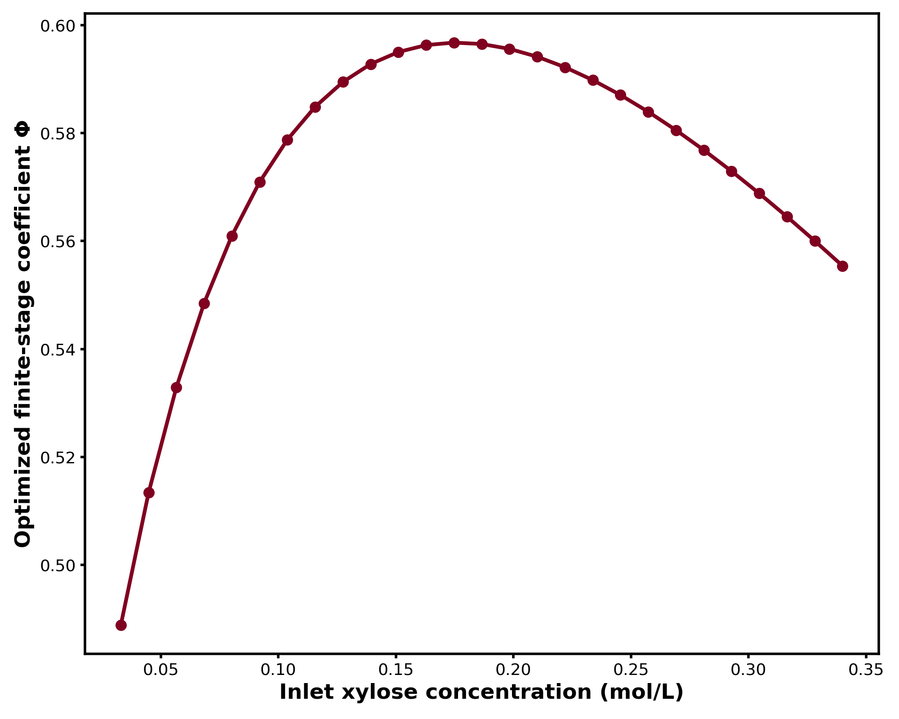
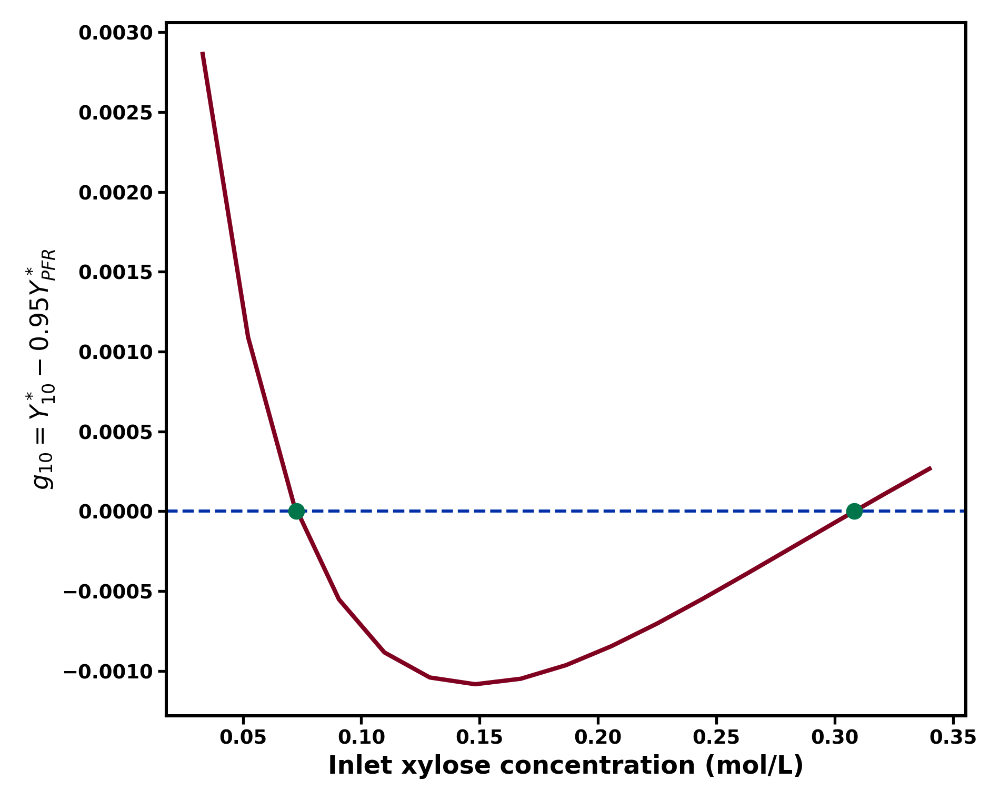

# CSTR Convergence

**Reaction kinetics, finite-stage accuracy, and reactor design decisions.**

`cstr-convergence` is a Python toolkit for calculating how equal-volume continuous stirred-tank reactor (CSTR) cascades approach plug-flow reactor (PFR) performance. It links kinetic models and selected reaction objectives to the minimum stage number needed to meet a specified performance target.

The toolkit supports exact finite-stage calculations, objective-specific first- and second-order coefficients **Φ** and **Ψ**, and numerical identification of concentration and kinetic-parameter boundaries at which the required reactor configuration changes.

## Results: nonlinear xylose reaction network



The nonlinear network contains sequential furfural formation, first-order furfural loss, and bimolecular intermediate–furfural degradation. At the reference kinetic condition, the optimized leading coefficient Φ reaches an interior maximum as feed concentration changes.

| Inlet xylose (mol/L) | Φ | Ψ | Exact N for 95% PFR yield retention |
| ---: | ---: | ---: | ---: |
| 0.033 | 0.488891 | -0.579825 | 9 |
| 0.176 | 0.596736 | -1.344407 | 11 |
| 0.340 | 0.555396 | -1.354615 | 10 |

For independently optimized PFR and finite-stage furfural yields, define

\[
\epsilon_N=\frac{Y_{\mathrm{PFR}}^*-Y_N^*}{Y_{\mathrm{PFR}}^*}
=\frac{\Phi}{N}+\frac{\Psi}{N^2}+O(N^{-3}).
\]

The coefficient Ψ is computed from the second-order kinetic perturbation, including the shift in optimum residence time. The minimum integer stage count is calculated using the exact finite-stage model.



For a **10-stage CSTR cascade** and **95% furfural-yield retention**, the exact configuration-margin function crosses zero at **0.07264792** and **0.30825680 mol/L**. The prescribed configuration therefore changes feasibility as inlet composition varies.

```bash
python examples/second_order_boundaries.py --plot
```

## Decision-oriented kinetic sensitivity

At 0.0769 mol/L inlet xylose, perturb only the `I + F` cross-degradation coefficient:

| Multiplier | Φ | Exact N95 |
| ---: | ---: | ---: |
| 0.70 | 0.5287 | 10 |
| 1.00 | 0.5577 | 11 |
| 1.30 | 0.5764 | 11 |

A continuous change in Φ changes the required integer stage number in one direction, while the other parameter change leaves the design unchanged. The exact 10-stage feasibility boundary occurs at **0.94470637 ×** the baseline cross-degradation coefficient.

For a separate first-order benchmark, the repository includes a controlled scan of Damköhler-number uncertainty. It illustrates how a broad kinetic range may preserve the stage decision while a smaller range spanning an integer-stage boundary changes it.

```bash
python examples/decision_sensitivity.py
python examples/stage_uncertainty.py
```

## Installation

Python 3.10+ is required.

```bash
python -m pip install -e ".[dev,plot]"
python -m pytest -q
```

## Available models and methods

- **Single power-law reactions:** PFR and finite-CSTR conversion, including zero-order depletion and fractional reaction orders.
- **First-order consecutive reactions:** analytical PFR and exact finite-CSTR solutions for `A -> B -> C`, optimized intermediate yield, and stage requirements.
- **Nonlinear xylose dehydration:** optimized PFR/CSTR furfural yield, Φ, Ψ, exact integer stage counts, and kinetic sensitivity.
- **Configuration-boundary analysis:** exact yield-retention margins and roots in feed concentration or kinetic-parameter space.
- **Stage-count calculations:** exact integer requirements, asymptotic estimates, and bounded searches for nonmonotone performance errors.

Equal-volume CSTR staging corresponds to backward-Euler integration of the PFR reaction equations. The kinetic network and chosen objective control how this finite discretization affects conversion, yield or selectivity.

## Examples and documentation

```bash
python examples/demo.py
python examples/xylose_benchmarks.py
python examples/xylose_phi_sweep.py
python examples/second_order_boundaries.py --plot
```

- [KINETIC_MODEL.md](KINETIC_MODEL.md): network definitions, parameter origin, and calculations.
- [NUMERICAL_VERIFICATION.md](NUMERICAL_VERIFICATION.md): coefficient and boundary regression targets.
- [CHANGELOG.md](CHANGELOG.md): release history.
- [CITATION.cff](CITATION.cff): how to cite the software and associated research.

## Verification and assumptions

Automated tests cover analytical reactor solutions, mass balance, concentration depletion, matched and widely separated rate constants, cross-checks with independent ODE integration, reference values for Φ and Ψ, exact stage counts, configuration boundaries, and large-N finite-stage convergence. GitHub Actions runs tests on pushes and pull requests.

The calculations apply to steady, isothermal, constant-volumetric-flow reactors with equal-volume ideal CSTR stages. Asymptotic approximations describe the large-N regime; integer decisions are obtained from the optimized finite-stage reactor calculations. The `persistent` error option checks the explicitly specified finite stage-count interval.

## Planned extensions

Composition-dependent kinetic inference, nonisothermal thermal histories, experimentally measured residence-time distributions, and links to downstream separation objectives.

## Research citation

W. Wang, [*Kinetic Criteria for Finite CSTR Staging toward Plug-Flow Performance*](https://doi.org/10.26434/chemrxiv.15007934/v1), ChemRxiv (2026). The research reference documents the kinetic criteria; this repository provides an independent, executable software implementation and examples.
